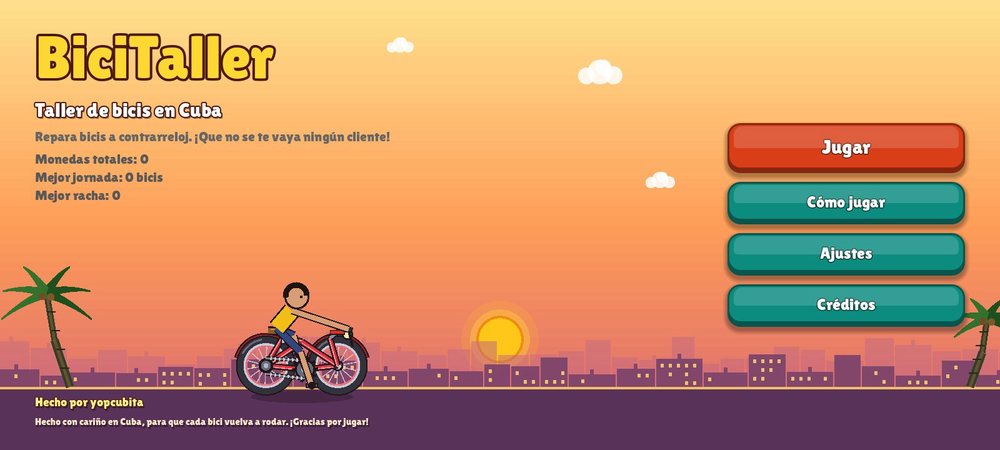
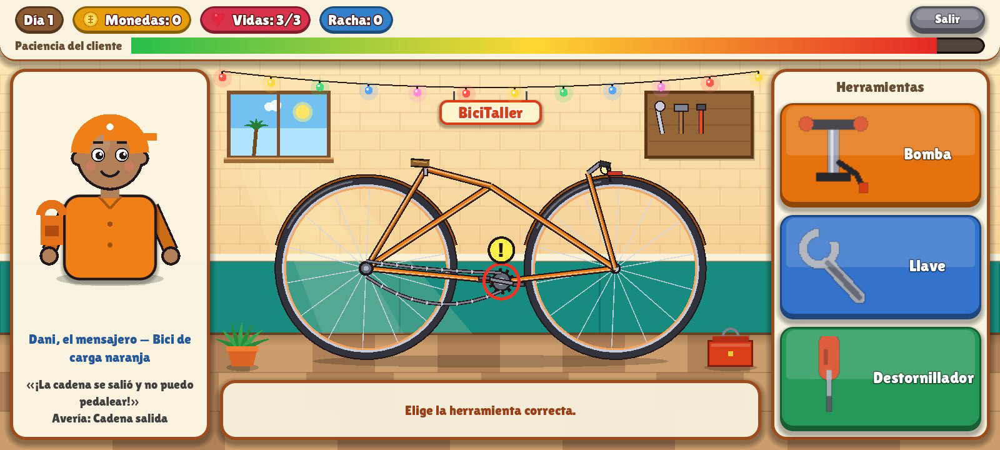
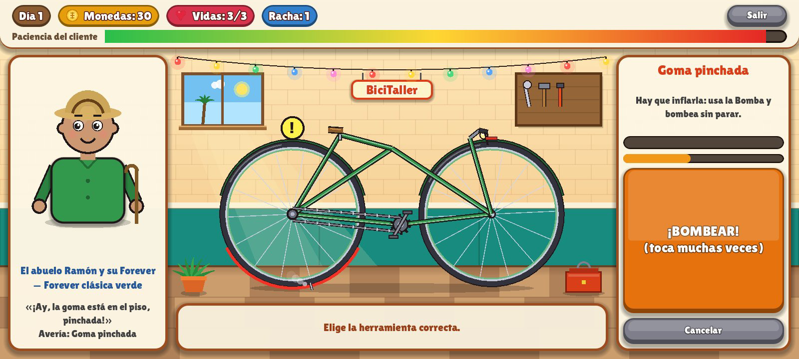
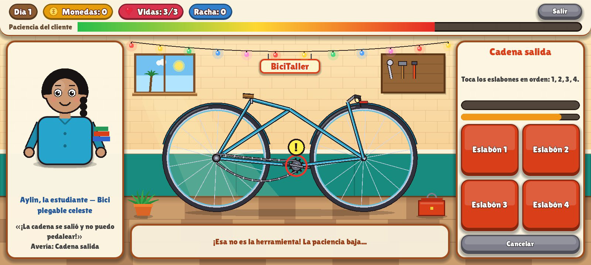
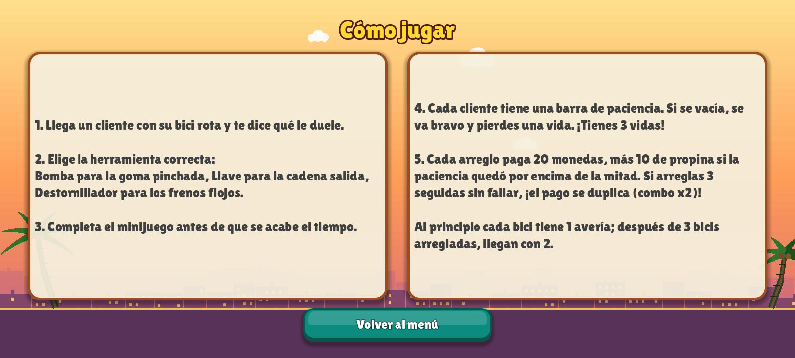

# 🚲 BiciTaller

**Repara bicis a contrarreloj en tu propio taller: clientes impacientes, herramientas, minijuegos y propinas.**

[](LICENSE)
[](CHANGELOG.md)
[](https://godotengine.org/)
[](https://docs.godotengine.org/en/stable/tutorials/scripting/gdscript/index.html)
[](https://developer.android.com/)

## ¿Qué es BiciTaller?

BiciTaller es un juego arcade 2D para Android en el que eres la mecánica de un taller de bicicletas en Cuba. Llegan clientes con su bici rota, te dicen qué le duele y tienes que arreglarla a contrarreloj: si la barra de paciencia se vacía, el cliente se va bravo y pierdes una vida.

Es un juego **offline**, pensado para jugar sin internet y con poca batería: 30 FPS, arte dibujado con código y sin permisos de red.

Hecho con cariño en Cuba, para que cada bici vuelva a rodar.

## 📸 Capturas

| Menú | Taller |
| --- | --- |
|  |  |

| Minijuego | Cliente |
| --- | --- |
|  |  |

### Cómo jugar



## ✨ Características

- **Jornada arcade:** 8 clientes por jornada, 3 vidas y clientes impacientes con barra de paciencia.
- **3 averías con minijuegos:** goma pinchada (bomba), cadena salida (llave) y frenos flojos (destornillador).
- **Monedas, propina y combo x2:** cada arreglo paga 20 monedas, más 10 de propina si la paciencia quedó por encima de la mitad; 3 arreglos seguidos sin fallar duplican el pago.
- **Guardado local:** el progreso y los ajustes se guardan en el teléfono.
- **Sonido:** 13 efectos y música de fondo en bucle, con interruptores separados de Sonido y Música en Ajustes.
- **Arte dibujado con código:** clientes con expresiones que cambian con la paciencia, bici con radios y pedales que giran, taller con ladrillo, guirnalda y ventana con sol.
- **Horizontal 1280×720**, botones grandes para los pulgares y botón «atrás» de Android para cancelar el minijuego.

## 🎮 Cómo se juega

1. Lee el síntoma del cliente.
2. Elige la herramienta correcta: **bomba** para la goma, **llave** para la cadena, **destornillador** para los frenos.
3. Completa el minijuego antes de que se acabe el tiempo:
   - **Goma:** toca muchas veces el botón de bombear hasta llenar el aire.
   - **Cadena:** toca los eslabones en orden: 1, 2, 3, 4.
   - **Frenos:** mantén pulsado para mover la aguja y suelta dentro de la zona verde (45 a 75).
4. Herramienta equivocada o minijuego fallido: la paciencia baja y la racha se reinicia. Después de 3 bicis arregladas, las siguientes llegan con 2 averías.

## 🛠️ Stack tecnológico

| Tecnología | Uso |
| --- | --- |
|  | Motor del juego |
|  | Lenguaje de programación |
|  | Plataforma (APK) |
| Python + numpy | Generación de los sonidos (`tools/gen_audio.py`) |
| Lilita One (OFL) | Tipografía arcade |

## 🚀 Instalación y uso

### Requisitos previos

- [Godot 4.3](https://godotengine.org/download/) (editor)
- Plantillas de exportación de Android para Godot 4.3
- JDK 17 y Android SDK (API 34) para exportar el APK
- Python 3 + numpy, solo si quieres regenerar los sonidos

### Clonar y abrir el proyecto

```bash
git clone https://github.com/yopcubita/bicitaller.git
cd bicitaller
```

1. Abre Godot 4.3 y elige **Importar**.
2. Selecciona la carpeta del proyecto (`project.godot`).
3. Abre la escena `scenes/Main.tscn` y pulsa **Play** (F5).

### Exportar el APK

1. En Godot: **Proyecto > Exportar**, preset **Android**.
2. El APK se exporta a `build/android/BiciTaller.apk`.
3. Paquete: `com.yopcubita.bicitaller`, versión 0.6.1 (versionCode 7), sin permiso de internet (solo vibración).

Para regenerar los sonidos:

```bash
python3 tools/gen_audio.py
```

## 📁 Estructura del proyecto

```
BiciTaller/
├── project.godot          # Configuración del proyecto (Godot 4.3)
├── export_presets.cfg     # Preset de exportación Android
├── icon.svg               # Icono de la app
├── scenes/
│   └── Main.tscn          # Escena principal (una sola escena)
├── scripts/
│   ├── main.gd            # Menú, jornada arcade, minijuegos y resultados
│   ├── client_view.gd     # Retrato del cliente y su ánimo
│   ├── bike_view.gd       # La bici y su avería, dibujadas con código
│   ├── workshop_bg.gd     # Fondo del taller
│   ├── scene_bg.gd        # Fondo de atardecer de los menús
│   ├── zone_bar.gd        # Barra de zona verde del minijuego de frenos
│   ├── ui.gd              # Paleta y construcción de la interfaz
│   ├── gfx.gd             # Utilidades de dibujo compartidas
│   ├── icons.gd           # Iconos de herramientas, moneda y corazón
│   ├── data.gd            # Clientes, averías y textos de créditos
│   ├── sfx.gd             # Autoload Sfx: efectos y música
│   └── save.gd            # Autoload Save: guardado local
├── assets/
│   ├── audio/             # 13 efectos + música (WAV generados)
│   └── fonts/             # Lilita One (SIL Open Font License)
├── tools/
│   └── gen_audio.py       # Genera todos los sonidos (Python + numpy)
└── docs/
    └── screenshots/       # Capturas del juego
```

## 🗺️ Roadmap

- [x] Prototipo jugable (v0.1.0)
- [x] Arte renovado (v0.2.0)
- [x] Corrección de 7 defectos de layout (v0.3.0)
- [x] Juego horizontal 1280×720 (v0.4.0)
- [x] Gráficos arcade: Lilita One, botones caramelo, taller nuevo (v0.5.0)
- [x] Sonido: 13 efectos + música en bucle (v0.6.0)
- [x] Caras de los clientes corregidas (v0.6.1)
- [ ] Tienda y mejoras
- [ ] Modo armar bici desde cero
- [ ] Publicar en una tienda de apps

## 🤝 Contribución

¿Quieres ayudar? Lee [CONTRIBUTING.md](CONTRIBUTING.md). Puedes reportar errores, proponer ideas o enviar *pull requests*.

## 📄 Licencia

Este proyecto está bajo la licencia MIT. Ver [LICENSE](LICENSE).

## 👩‍💻 Autora

**yopcubita** — [github.com/yopcubita](https://github.com/yopcubita)

> Hecho por yopcubita — Hecho con cariño en Cuba, para que cada bici vuelva a rodar. ¡Gracias por jugar!
